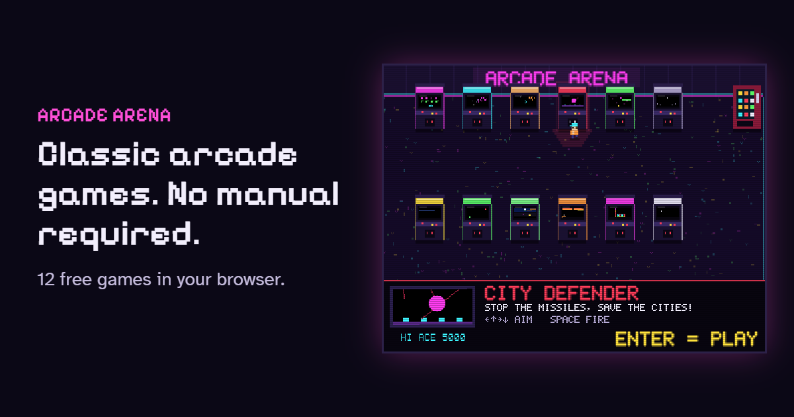

<div align="center">



# 🕹️ Arcade Arena

**Classic arcade games. No manual required.**

Walk into a neon arcade hall in your browser, step up to a cabinet, press Enter and play.<br/>
No sign-up, no download, high score tables with three-letter initials, just like back in the day.

[](https://arcadearena.sfalter.de)


</div>

---

## ✨ Why Arcade Arena?

Modern games often want hours of tutorials, and after a week away you have forgotten everything. Arcade Arena works the other way round: **walk up, play a round, walk away.**

|   |   |
|---|---|
| 🔠 **Large, clear text** | Big pixel lettering and strong contrast on every screen |
| 🎮 **Two buttons, no menus** | Arrow keys plus one or two buttons, the same in every game |
| ⏱️ **Short rounds** | Two to ten minutes, nothing to save, nothing to unlock |
| 🏆 **High score tables** | Top 10 per cabinet with your three initials |
| 🕹️ **Keyboard or gamepad** | Xbox, PlayStation and Switch Pro controllers work out of the box |
| 🎬 **Attract mode** | Every cabinet plays a demo of itself while it waits for you |

## 👾 The cabinets

Twelve original games, each inspired by a golden-age classic, with their own names, graphics and sounds.

| | Cabinet | In the spirit of | Controls |
|:-:|---|---|---|
| 👽 | **Cosmic Siege** | Space Invaders | `←` `→` move · `Space` fire |
| 🚀 | **Star Run** | 3D cockpit rail shooter | arrows steer · `Space` fire · `Shift` bomb |
| ☄️ | **Rock Buster** | Asteroids | `←` `→` turn · `↑` thrust · `Space` fire · `Shift` warp |
| 🏙️ | **City Defender** | Missile Command | arrows aim · `Space` fire |
| 🐛 | **Garden Guard** | Centipede | arrows move · `Space` fire |
| 🌙 | **Moon Lander** | Lunar Lander | `←` `→` turn · `Space` thrust |
| 🟡 | **Maze Muncher** | Pac-Man | arrows |
| 🐍 | **Neon Serpent** | Snake | arrows |
| 🐸 | **Road Hopper** | Frogger | arrows |
| 🧱 | **Brick Blaster** | Breakout | `←` `→` move · `Space` launch |
| 💎 | **Gem Cascade** | Columns | `←` `→` move · `↓` faster · `Space` swap · `Shift` drop |
| 🏓 | **Paddle Duel** | Pong (vs. the computer) | `↑` `↓` |

## 🎮 Controls

The same layout in every game:

| Action | Keyboard | Gamepad |
|---|---|---|
| Walk / move | `←` `↑` `→` `↓` or `W` `A` `S` `D` | D-pad or left stick |
| Button 1 | `Space` | `A` / `X` |
| Button 2 | `Shift` | `B` / `Y` |
| Start / pause | `Enter` (or `P` to pause) | `Start` |
| Back to the hall | `Esc` (asks first during a game) | `Select` / `Back` |
| Sound on/off | `M` (hall and pause menu) | |
| Fullscreen | `F` (in the hall) | |

🖱️ In the hall you can also use the mouse: click a cabinet and your character walks over and starts the game. Walk out through the **EXIT** door to get back to the homepage.

🎶 Next to the sofa stands a **record player**. Press `Enter` there to put on a record and again for the next one (`Shift` stops the music). Six original tracks in the style of 70s disco and funk, 80s synth pop and Italo disco and 90s eurodance. The music keeps playing softly and muffled while you play a game, like it is coming from the hall next door.

## 🚀 Getting started

Requires [Node.js](https://nodejs.org/) (developed with Node 24).

```bash
npm install
npm run dev       # start the dev server
npm run build     # type check + production build into dist/
npm run preview   # serve the production build locally
```

The site has two entry points:

| Path | File | What it is |
|---|---|---|
| `/` | `index.html` | Landing page with live game previews, FAQ and structured data |
| `/play/` | `play/index.html` | The arcade hall |

## 🛠️ Under the hood

- **TypeScript + Vite**, no framework, zero runtime dependencies
- **Canvas 2D** at a fixed 384×288 resolution, scaled up to fill the window, with a CRT look (scanlines, vignette, neon bloom)
- **WebAudio** synthesizes every sound effect, loop and record-player track; there are no audio files
- **localStorage** keeps high scores and settings; nothing is sent to a server
- **Self-hosted fonts** via Fontsource (Pixelify Sans, Atkinson Hyperlegible)

<details>
<summary><b>📁 Project structure</b></summary>

```text
index.html              landing page
play/index.html         arcade hall
src/
  main.ts               hall entry point: switches between hall and games
  engine/               shared building blocks
    loop.ts               fixed-timestep game loop (60 Hz)
    input.ts              keyboard, mouse, gamepad
    sound.ts, sfx.ts      WebAudio synthesis, looping sounds, shared effects
    music.ts              record player: sequencer and instruments for the hall music
    shell.ts              cabinet flow: title, demo, pause, game over, initials, high scores
    autopilot.ts          "demo player" for attract mode
    font.ts, draw.ts      bitmap font, sprites, pixel-perfect lines
    screen.ts             scaling, CRT effects, fullscreen
    highscores.ts         high score tables
  hall/hall.ts          the walkable arcade hall
  hall/records.ts       the records in the crate (original songs, notes and chords)
  games/<name>/         one folder per game (index.ts + round.ts, sometimes sprites/sounds)
  games/registry.ts     which cabinets stand where in the hall
  landing/              landing page script and styles
scripts/
  add-landing-game.mjs  adds a new game to the landing page
```

</details>

## ➕ Adding a game

Each game only provides its actual round of play. Title screen, demo mode, pause, game over, initials entry and the high score table all come from `CabinetShell` for free.

1. **Round** in `src/games/<name>/round.ts`: a class implementing `Round` from `src/engine/shell.ts` (`update(dt)`, `render(g)`, `score`, `over`). Read input through `env.input` and play sounds through `env.audio`, so the attract-mode autopilot works without extra code.
2. **Cabinet** in `src/games/<name>/index.ts`: a `CabinetInfo` (name, tagline, colors, controls, tiny demo for the cabinet screen) and a `GameDefinition` (how-to text, optional score table, `createRound`).
3. **Place it** in `src/games/registry.ts` by adding it to `CABINETS`. The hall holds six cabinets per row and grows new rows automatically.
4. **Landing page**: write a small JSON spec (title, description, keys and so on) and run

   ```bash
   node scripts/add-landing-game.mjs path/to/spec.json
   ```

   It adds the game card with a live preview, the JSON-LD entry, the `llms.txt` line and the preview wiring. Running it twice is safe. The expected fields are listed at the top of the script.

> [!TIP]
> Design rules for every game (see `PLAN.md`): arrow keys plus at most two buttons, understandable within five seconds, rounds of two to ten minutes, easy-to-read text.

## 🌐 Deployment

`npm run build` produces a fully static site in `dist/` that runs on any static host (Cloudflare Pages, Netlify, GitHub Pages and so on).

> [!NOTE]
> The public address `https://arcadearena.sfalter.de` is hardcoded in `index.html`, `play/index.html`, `vite.config.ts` and `scripts/add-landing-game.mjs`. It is used for canonical links, Open Graph, structured data, `sitemap.xml`, `robots.txt` and `llms.txt`. The last three are generated by `vite.config.ts` during the build.

## ⚖️ Legal

Arcade Arena is an independent hobby project. Game mechanics are free to use, so every game has its own name, graphics and sounds. Space Invaders, Pac-Man, Asteroids, Breakout, Pong, Frogger, Missile Command, Centipede, Lunar Lander and Columns are trademarks of their respective owners. Arcade Arena is not affiliated with them.

<div align="center">

---

**Insert coin to continue** 🪙

</div>
